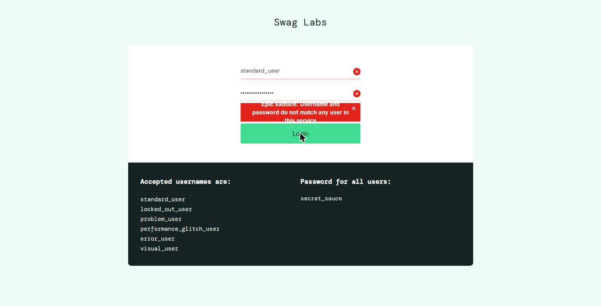
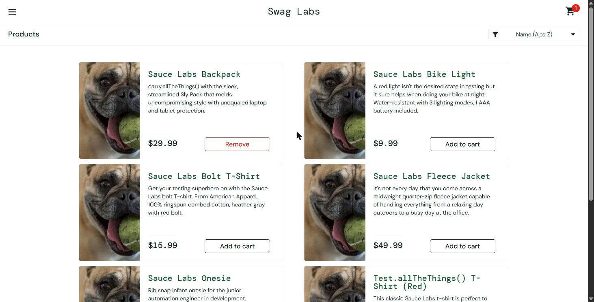
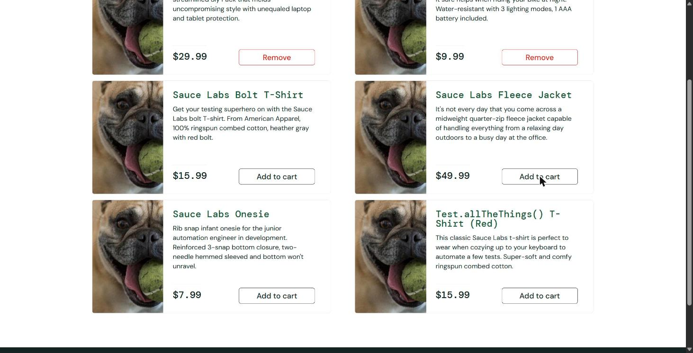
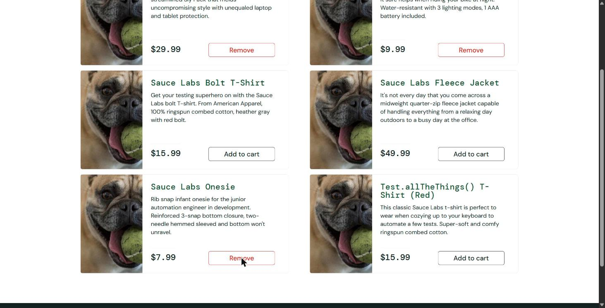
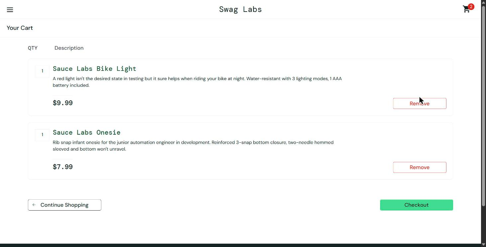
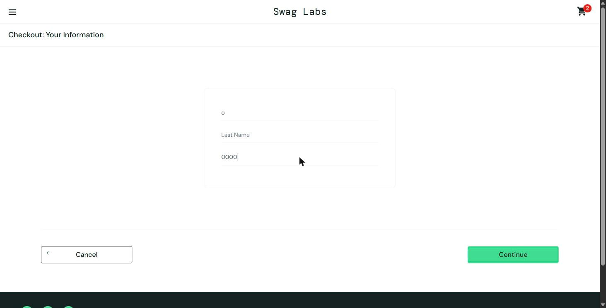
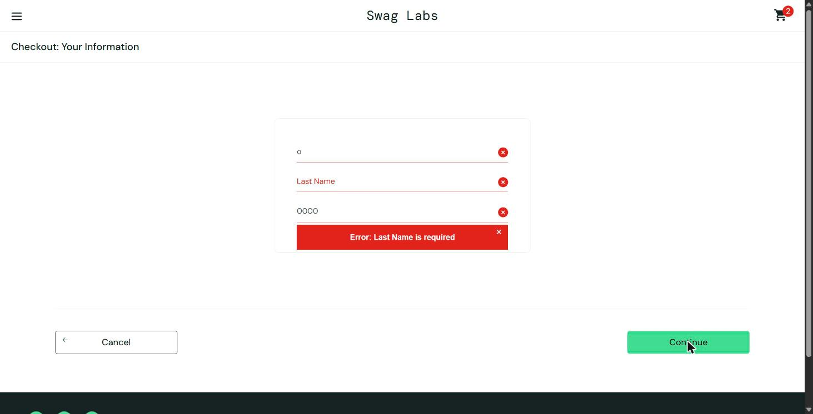

# Bugs encontrados — SauceDemo

Aplicación: https://www.saucedemo.com/ · Fecha: 20/10/2026 · Plantilla: *Bug report template* (versión con la plantilla original en `bugs_encontrados.docx`).
Prioridad y severidad: escala 1 a 5, donde 1 es la más alta. UI = defecto visual, F = defecto funcional.

| ID | Título | Prioridad | Severidad | Caso |
|---|---|---|---|---|
| BUG-01-UI | El mensaje de error del login se muestra cortado | Baja 1-5 → 4 | Baja 1-5 → 4 | TC-002 |
| BUG-02-UI | Todos los productos muestran la misma imagen con problem_user | Media 1-5 → 3 | Media 1-5 → 3 | TC-006 |
| BUG-03-F | El botón Add to cart no responde en 3 de 6 productos con problem_user | Alta 1-5 → 2 | Alta 1-5 → 2 | TC-006 |
| BUG-04-F | El botón Remove del catálogo no responde con problem_user | Media 1-5 → 3 | Media 1-5 → 3 | TC-006 |
| BUG-05-F | El campo Last Name sobrescribe First Name en el checkout con problem_user | Crítica 1-5 → 1 | Crítica 1-5 → 1 | TC-007 |
| BUG-06-F | El carrito conserva productos al cerrar sesión y cambiar de usuario | Media 1-5 → 3 | Media 1-5 → 3 | TC-004 y TC-006 |

---

## #BUG-01-UI · Bug Report

| Campo | Detalle |
|---|---|
| Title | El mensaje de error del login se muestra cortado |
| Descripción | Al intentar iniciar sesión con credenciales inválidas, el cuadro rojo con el mensaje de error recorta el texto en sus bordes superior e inferior, y el mensaje no se lee completo. |
| Pasos | 1.- Ingresar a https://www.saucedemo.com/ 2.- Escribir standard_user en Username 3.- Escribir clave_incorrecta en Password 4.- Hacer clic en Login Referencia: TC-002 |
| RESULTADO ACTUAL | El mensaje “Epic sadface: Username and password do not match any user in this service” se muestra cortado: “Epic sadface” queda cortado arriba y “this service” abajo. Se reproduce siempre (2 de 2 intentos). |
| RESULTADO ESPERADO | Se espera que el mensaje de error se vea completo y legible dentro del cuadro rojo. |
| PRIORIDAD | Baja 1-5 → 4 |
| SEVERIDAD | Baja 1-5 → 4 |
| AMBIENTE | Usuario de prueba = standard_user Dispositivo = PC/LAPTOP Sistema operativo = Windows (NT 10.0, 64 bits) Navegador = Google Chrome 155 Versión del software = No aplica |
| COMENTARIOS | Es un defecto visual: el texto sí está completo en la página. Afecta la claridad del error, pero el usuario entiende que el acceso fue rechazado. |

**ADJUNTOS**

---

## #BUG-02-UI · Bug Report

| Campo | Detalle |
|---|---|
| Title | Todos los productos muestran la misma imagen con problem_user |
| Descripción | Al iniciar sesión como problem_user, los 6 productos del catálogo muestran la misma foto de un perro en lugar de la imagen propia de cada producto. |
| Pasos | 1.- Ingresar a https://www.saucedemo.com/ 2.- Iniciar sesión con problem_user 3.- Observar las imágenes de los 6 productos del catálogo Referencia: TC-006 |
| RESULTADO ACTUAL | Los 6 productos usan el mismo archivo de imagen (/assets/sl-404-…jpg), una foto de un perro con una pelota. |
| RESULTADO ESPERADO | Se espera que cada producto muestre su imagen: mochila, luz de bicicleta, camisetas, chaqueta y body. |
| PRIORIDAD | Media 1-5 → 3 |
| SEVERIDAD | Media 1-5 → 3 |
| AMBIENTE | Usuario de prueba = problem_user Dispositivo = PC/LAPTOP Sistema operativo = Windows (NT 10.0, 64 bits) Navegador = Google Chrome 155 Versión del software = No aplica |
| COMENTARIOS | El usuario no puede distinguir los productos por su imagen. No impide la compra, pero daña la experiencia. |

**ADJUNTOS**

---

## #BUG-03-F · Bug Report

| Campo | Detalle |
|---|---|
| Title | El botón Add to cart no responde en 3 de 6 productos con problem_user |
| Descripción | Con problem_user, al hacer clic en Add to cart de Sauce Labs Bolt T-Shirt, Sauce Labs Fleece Jacket y Test.allTheThings() T-Shirt (Red), el producto no se agrega: el botón no cambia y el contador del carrito no aumenta. |
| Pasos | 1.- Iniciar sesión con problem_user en https://www.saucedemo.com/ 2.- En el catálogo, hacer clic en Add to cart de Sauce Labs Bolt T-Shirt 3.- Repetir con Sauce Labs Fleece Jacket 4.- Repetir con Test.allTheThings() T-Shirt (Red) 5.- Comparar con Bike Light y Onesie Referencia: TC-006 |
| RESULTADO ACTUAL | Bike Light y Onesie sí cambian a Remove y suben el contador. Bolt T-Shirt, Fleece Jacket y Test.allTheThings() T-Shirt (Red) siguen con Add to cart y el contador no cambia. Se reprodujo en Bolt y Fleece dos veces. |
| RESULTADO ESPERADO | Se espera que el botón de cada producto cambie a Remove y el contador aumente en 1. |
| PRIORIDAD | Alta 1-5 → 2 |
| SEVERIDAD | Alta 1-5 → 2 |
| AMBIENTE | Usuario de prueba = problem_user Dispositivo = PC/LAPTOP Sistema operativo = Windows (NT 10.0, 64 bits) Navegador = Google Chrome 155 Versión del software = No aplica |
| COMENTARIOS | El usuario no puede comprar la mitad del catálogo. No existe una alternativa visible para agregar esos productos. |

**ADJUNTOS**

---

## #BUG-04-F · Bug Report

| Campo | Detalle |
|---|---|
| Title | El botón Remove del catálogo no responde con problem_user |
| Descripción | Con problem_user, el botón Remove de los productos en el catálogo no elimina el producto del carrito. Los 3 productos probados siguieron en el carrito con el contador sin cambios. |
| Pasos | 1.- Iniciar sesión con problem_user en https://www.saucedemo.com/ 2.- Agregar Sauce Labs Bike Light y Sauce Labs Onesie al carrito (el Backpack ya estaba) 3.- En el catálogo, hacer clic en Remove de Backpack, Bike Light y Onesie 4.- Comparar con Remove dentro del carrito Referencia: TC-006 |
| RESULTADO ACTUAL | Los tres botones siguen en Remove y el contador se mantiene en 3. Dentro del carrito, Remove sí elimina el producto. |
| RESULTADO ESPERADO | Se espera que el botón vuelva a Add to cart y el contador disminuya. |
| PRIORIDAD | Media 1-5 → 3 |
| SEVERIDAD | Media 1-5 → 3 |
| AMBIENTE | Usuario de prueba = problem_user Dispositivo = PC/LAPTOP Sistema operativo = Windows (NT 10.0, 64 bits) Navegador = Google Chrome 155 Versión del software = No aplica |
| COMENTARIOS | Existe una alternativa: eliminar desde el carrito. Aun así, el comportamiento es inconsistente entre ambas pantallas. |

**ADJUNTOS**

---

## #BUG-05-F · Bug Report

| Campo | Detalle |
|---|---|
| Title | El campo Last Name sobrescribe First Name en el checkout con problem_user |
| Descripción | Con problem_user, al escribir el apellido en el campo Last Name, el texto se ingresa en First Name y lo sobrescribe. Last Name queda vacío y el formulario no permite continuar. |
| Pasos | 1.- Iniciar sesión con problem_user en https://www.saucedemo.com/ 2.- Agregar un producto al carrito y hacer clic en Checkout 3.- Escribir Sebastian en First Name 4.- Escribir Camacho en Last Name 5.- Escribir 0000 en Zip/Postal Code y hacer clic en Continue Referencia: TC-007 |
| RESULTADO ACTUAL | First Name queda con “o” (la última letra escrita) y Last Name vacío. Al presionar Continue aparece “Error: Last Name is required”. |
| RESULTADO ESPERADO | Se espera que Last Name conserve “Camacho”, First Name conserve “Sebastian” y se avance al resumen de compra. |
| PRIORIDAD | Crítica 1-5 → 1 |
| SEVERIDAD | Crítica 1-5 → 1 |
| AMBIENTE | Usuario de prueba = problem_user Dispositivo = PC/LAPTOP Sistema operativo = Windows (NT 10.0, 64 bits) Navegador = Google Chrome 155 Versión del software = No aplica |
| COMENTARIOS | Impide completar la compra y no hay una alternativa. Los valores se comprobaron con JavaScript: first=“o”, last=“”, zip=“0000”. |

**ADJUNTOS**

---

## #BUG-06-F · Bug Report

| Campo | Detalle |
|---|---|
| Title | El carrito conserva productos al cerrar sesión y cambiar de usuario |
| Descripción | Después de cerrar sesión con standard_user e iniciar sesión con otro usuario (problem_user), el carrito todavía contiene el producto que dejó el usuario anterior. |
| Pasos | 1.- Iniciar sesión con standard_user y dejar Sauce Labs Backpack en el carrito 2.- Cerrar sesión desde el menú (Logout) 3.- Iniciar sesión con problem_user 4.- Observar el contador y el botón del Backpack en el catálogo Referencia: TC-004 y TC-006 |
| RESULTADO ACTUAL | Con problem_user el carrito muestra el contador 1 y el Backpack ya aparece con el botón Remove. |
| RESULTADO ESPERADO | Se espera que el carrito de un usuario nuevo comience vacío y no muestre datos de otra sesión. |
| PRIORIDAD | Media 1-5 → 3 |
| SEVERIDAD | Media 1-5 → 3 |
| AMBIENTE | Usuario de prueba = standard_user / problem_user Dispositivo = PC/LAPTOP Sistema operativo = Windows (NT 10.0, 64 bits) Navegador = Google Chrome 155 Versión del software = No aplica |
| COMENTARIOS | Un usuario puede ver o comprar productos que dejó otra persona en el mismo navegador. Es relevante en equipos compartidos. |

**ADJUNTOS**

