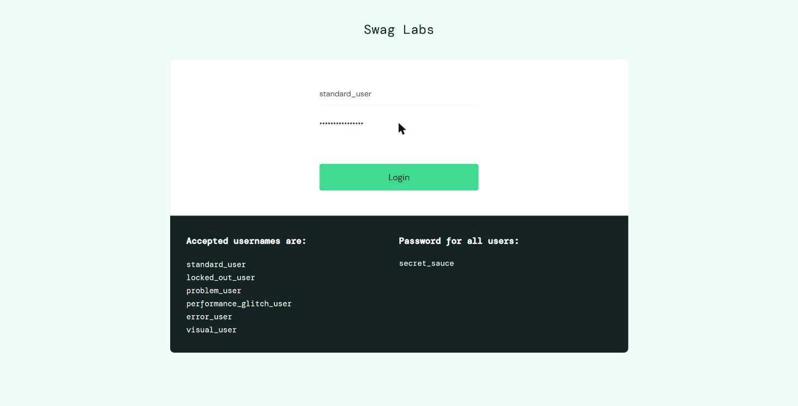
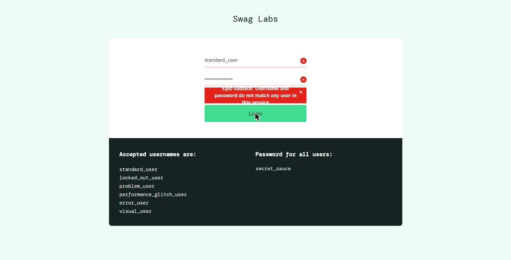
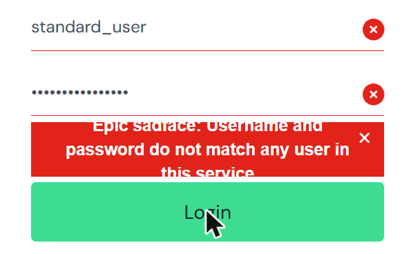
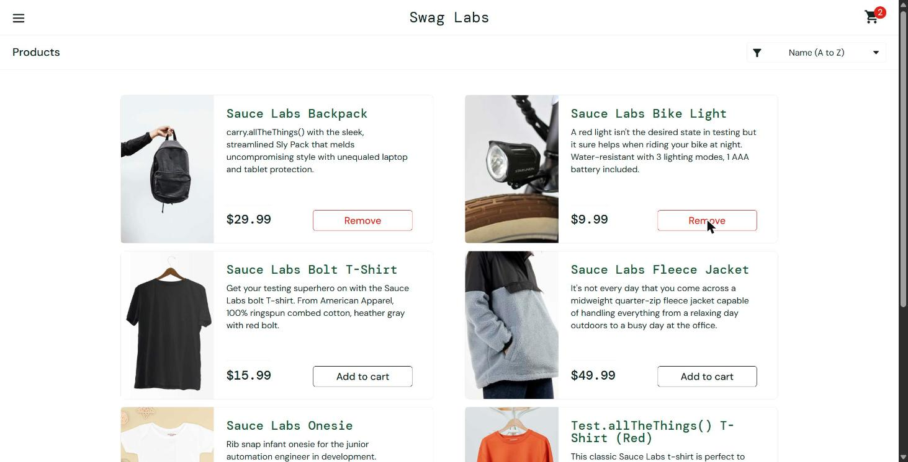
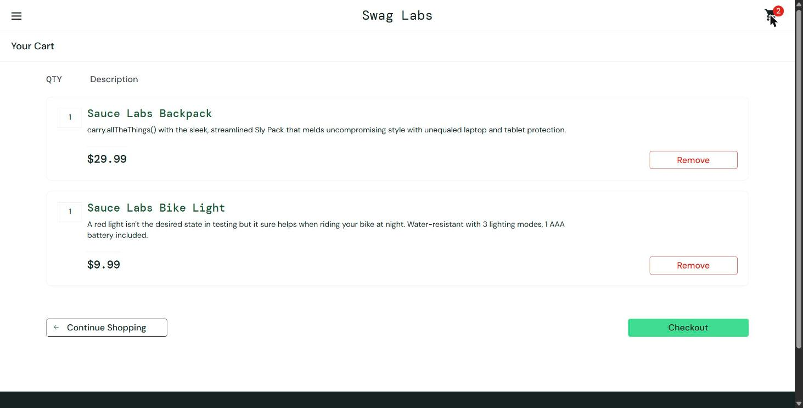
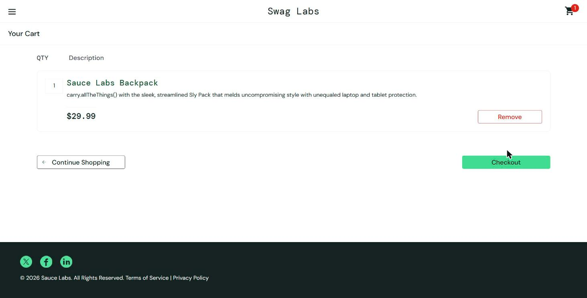
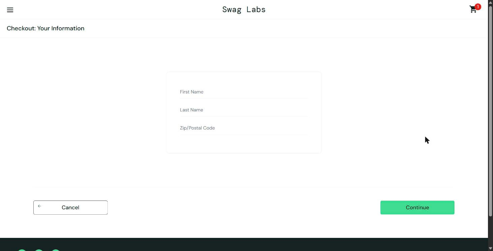
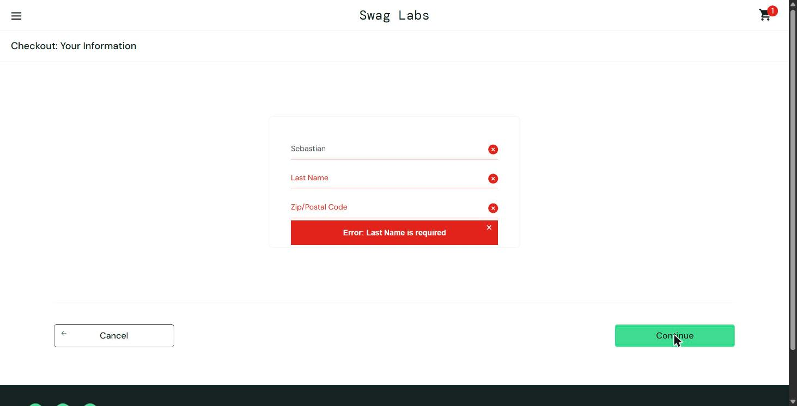
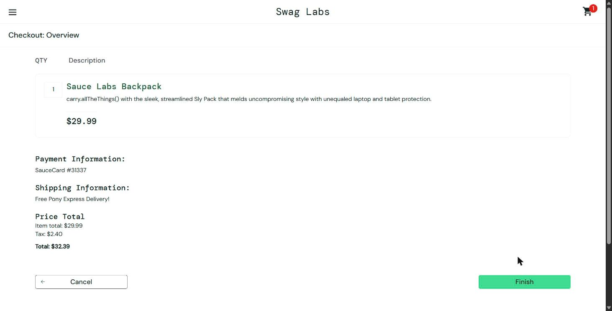

# Casos de caja negra — SauceDemo

Aplicación: https://www.saucedemo.com/ · Fecha de ejecución: 20/10/2026 · Tester: Sebastián Ariel Camacho Loayza

Plantilla: *Casos de prueba, plantilla para diseño y ejecución* (TQA). Versión con la plantilla original en `casos_caja_negra.docx`.
PASS = coincide; FAIL = diferencia verificable.

| ID | Caso | Estado | Defecto |
|---|---|---|---|
| TC-001 | Inicio de sesión con credenciales válidas | PASS | — |
| TC-002 | Inicio de sesión con contraseña incorrecta | FAIL | BUG-01-UI |
| TC-003 | Agregar productos al carrito | PASS | — |
| TC-004 | Eliminar un producto del carrito | PASS | — |
| TC-005 | Validación de campos obligatorios en el checkout | PASS | — |

---

## TC-001 · Inicio de sesión con credenciales válidas

### Parte 1 · Diseño del caso de prueba

| ID del TC | Título | Prioridad | Tipo | Módulo | Ambiente |
|---|---|---|---|---|---|
| TC-001 | Inicio de sesión con credenciales válidas | Alta | Funcional (positiva) | Inicio de sesión | Demo público (saucedemo.com), Chrome 155 / Windows |

**1. Objetivo (¿Qué se quiere validar?)**: Que un usuario con credenciales válidas pueda iniciar sesión y acceder al catálogo de productos.

**2. Precondiciones**

| Estado inicial | Navegador abierto en https://www.saucedemo.com/ con la sesión cerrada y los campos vacíos. |
|---|---|
| Usuario / permisos | Usuario estándar de demostración, sin permisos especiales. |
| Configuración | Google Chrome 155 en Windows, con conexión a internet. |

**3. Datos de prueba**

| Dato | Usuario / Contraseña |
|---|---|
| Valor | standard_user / secret_sauce |
| Origen | Usuarios de demostración publicados en la página de login |
| Observación | Usuario sin fallos intencionales del sitio. |

**4. Pasos y resultados esperados**

| # | Paso / acción | Dato utilizado | Resultado esperado |
|---|---|---|---|
| 1 | Abrir la URL de la aplicación | https://www.saucedemo.com/ | Se muestra el formulario de login con Username, Password y el botón Login. |
| 2 | Escribir el usuario en el campo Username | standard_user | El campo muestra el texto ingresado. |
| 3 | Escribir la contraseña en el campo Password | secret_sauce | El campo muestra la contraseña enmascarada. |
| 4 | Hacer clic en el botón Login | — | Se redirige a /inventory.html y se muestra el título Products con los productos. |

**5. Resultado esperado final (criterio de éxito)**: Se accede a la página de productos sin mensajes de error.

### Parte 2 · Ejecución de la prueba

| ID del TC | Ejecutado por | Fecha | Hora | Ambiente | Versión |
|---|---|---|---|---|---|
| TC-001 | Sebastián Ariel Camacho Loayza | 20/10/2026 | 21:15 | Demo público (saucedemo.com), Chrome 155 / Windows | Sin versión visible (sitio de demostración) |

**1. Resultado de la ejecución**: **PASS**

**2. Resultado observado**: Con standard_user y secret_sauce, el sitio redirigió a /inventory.html. Se mostró el título Products con 6 productos, cada uno con su precio y el botón Add to cart.

**Comparación**: Coincide con lo esperado. No hubo diferencias.

**3. Registro de ejecución por paso**

| # | Paso ejecutado | Resultado observado | Estado | Observación |
|---|---|---|---|---|
| 1 | Abrir la URL | Formulario de login visible | PASS | Ver captura 00. |
| 2 | Escribir usuario | Texto visible en Username | PASS | — |
| 3 | Escribir contraseña | Texto enmascarado | PASS | — |
| 4 | Clic en Login | Se abrió /inventory.html (Products) | PASS | Ver captura 01. |

**4. Evidencia**

- `evidencia_TC001_00_login_inicial.png`: Pantalla de login antes de ingresar credenciales, con la lista de usuarios de demostración.

  

- `evidencia_TC001_01_pagina_productos.png`: Página de productos (/inventory.html) tras iniciar sesión con standard_user.

  

**5. Si el resultado es FAIL**: N/A. El resultado fue PASS. Referencia del defecto: N/A

**6. Observaciones de ejecución**: Ninguna.

---

## TC-002 · Inicio de sesión con contraseña incorrecta

### Parte 1 · Diseño del caso de prueba

| ID del TC | Título | Prioridad | Tipo | Módulo | Ambiente |
|---|---|---|---|---|---|
| TC-002 | Inicio de sesión con contraseña incorrecta | Alta | Negativa | Inicio de sesión | Demo público (saucedemo.com), Chrome 155 / Windows |

**1. Objetivo (¿Qué se quiere validar?)**: Que el sistema rechace el acceso con una contraseña incorrecta y muestre un mensaje de error completo y legible.

**2. Precondiciones**

| Estado inicial | Navegador abierto en https://www.saucedemo.com/ con la sesión cerrada y los campos vacíos. |
|---|---|
| Usuario / permisos | Usuario estándar de demostración, sin permisos especiales. |
| Configuración | Google Chrome 155 en Windows, con conexión a internet. |

**3. Datos de prueba**

| Dato | Usuario / Contraseña |
|---|---|
| Valor | standard_user / clave_incorrecta |
| Origen | Usuario de demostración y contraseña inventada |
| Observación | La contraseña es inválida a propósito. |

**4. Pasos y resultados esperados**

| # | Paso / acción | Dato utilizado | Resultado esperado |
|---|---|---|---|
| 1 | Abrir la URL de la aplicación | https://www.saucedemo.com/ | Se muestra el formulario de login. |
| 2 | Escribir el usuario en el campo Username | standard_user | El campo muestra el texto ingresado. |
| 3 | Escribir la contraseña inválida en Password | clave_incorrecta | El campo muestra la contraseña enmascarada. |
| 4 | Hacer clic en el botón Login | — | Permanece en el login, los campos se marcan en rojo y el mensaje “Epic sadface: Username and password do not match any user in this service” se ve completo y legible. |

**5. Resultado esperado final (criterio de éxito)**: Se bloquea el acceso y el mensaje de error se muestra completo y legible.

### Parte 2 · Ejecución de la prueba

| ID del TC | Ejecutado por | Fecha | Hora | Ambiente | Versión |
|---|---|---|---|---|---|
| TC-002 | Sebastián Ariel Camacho Loayza | 20/10/2026 | 21:13 | Demo público (saucedemo.com), Chrome 155 / Windows | Sin versión visible (sitio de demostración) |

**1. Resultado de la ejecución**: **FAIL**

**2. Resultado observado**: El acceso fue rechazado y el sitio permaneció en el login. Los campos se marcaron en rojo y se mostró el texto correcto del mensaje, pero el cuadro rojo lo recorta: se cortan el borde superior de “Epic sadface” y el inferior de “this service”. Se repitió a las 21:16 con el mismo resultado.

**Comparación**: No coincide por completo. La lógica es correcta (acceso rechazado y mensaje correcto), pero el mensaje no es totalmente legible porque aparece recortado.

**3. Registro de ejecución por paso**

| # | Paso ejecutado | Resultado observado | Estado | Observación |
|---|---|---|---|---|
| 1 | Abrir la URL | Formulario de login visible | PASS | — |
| 2 | Escribir usuario | Texto visible en Username | PASS | — |
| 3 | Escribir contraseña inválida | Texto enmascarado | PASS | Ver captura 01. |
| 4 | Clic en Login | Acceso rechazado; mensaje con texto cortado arriba y abajo | FAIL | Ver capturas 02 y 03. Reproducido 2 veces. |

**4. Evidencia**

- `evidencia_TC002_01_datos_ingresados.png`: Formulario con el usuario y la contraseña inválida ingresados.

  

- `evidencia_TC002_02_mensaje_error.png`: Mensaje de error tras presionar Login, con el texto recortado.

  

- `evidencia_BUG01_01_zoom_mensaje_truncado.png`: Ampliación del mensaje de error que muestra el recorte (repetición a las 21:16).

  

**5. Si el resultado es FAIL**: El mensaje de error aparece recortado en los bordes superior e inferior del cuadro rojo; el texto no es completamente legible. Referencia del defecto: BUG-01-UI

**6. Observaciones de ejecución**: El texto completo sí está presente en la página. El recorte es solo visual.

---

## TC-003 · Agregar productos al carrito

### Parte 1 · Diseño del caso de prueba

| ID del TC | Título | Prioridad | Tipo | Módulo | Ambiente |
|---|---|---|---|---|---|
| TC-003 | Agregar productos al carrito | Alta | Funcional (positiva) | Catálogo y carrito | Demo público (saucedemo.com), Chrome 155 / Windows |

**1. Objetivo (¿Qué se quiere validar?)**: Que al agregar productos desde el catálogo se actualicen el botón del producto, el contador del carrito y el contenido del carrito.

**2. Precondiciones**

| Estado inicial | Sesión iniciada con standard_user en /inventory.html y carrito vacío (ícono sin contador). |
|---|---|
| Usuario / permisos | Usuario estándar de demostración (standard_user). |
| Configuración | Google Chrome 155 en Windows. Ordenamiento por defecto: Name (A to Z). |

**3. Datos de prueba**

| Dato | Productos |
|---|---|
| Valor | Sauce Labs Backpack ($29.99) y Sauce Labs Bike Light ($9.99), cantidad 1 de cada uno |
| Origen | Catálogo de SauceDemo |
| Observación | Se agregan desde el catálogo, no desde el detalle del producto. |

**4. Pasos y resultados esperados**

| # | Paso / acción | Dato utilizado | Resultado esperado |
|---|---|---|---|
| 1 | Hacer clic en Add to cart del producto Sauce Labs Backpack | Sauce Labs Backpack | El botón cambia a Remove y el contador del carrito muestra 1. |
| 2 | Hacer clic en Add to cart del producto Sauce Labs Bike Light | Sauce Labs Bike Light | El botón cambia a Remove y el contador del carrito muestra 2. |
| 3 | Hacer clic en el ícono del carrito | — | Se abre /cart.html con ambos productos, cantidad 1 y precios $29.99 y $9.99. |

**5. Resultado esperado final (criterio de éxito)**: El contador muestra 2 y el carrito lista exactamente los 2 productos seleccionados.

### Parte 2 · Ejecución de la prueba

| ID del TC | Ejecutado por | Fecha | Hora | Ambiente | Versión |
|---|---|---|---|---|---|
| TC-003 | Sebastián Ariel Camacho Loayza | 20/10/2026 | 21:15 | Demo público (saucedemo.com), Chrome 155 / Windows | Sin versión visible (sitio de demostración) |

**1. Resultado de la ejecución**: **PASS**

**2. Resultado observado**: Tras cada clic, el botón cambió a Remove y el contador pasó de 1 a 2. El carrito mostró Sauce Labs Backpack ($29.99) y Sauce Labs Bike Light ($9.99), con cantidad 1 cada uno.

**Comparación**: Coincide con lo esperado. No hubo diferencias.

**3. Registro de ejecución por paso**

| # | Paso ejecutado | Resultado observado | Estado | Observación |
|---|---|---|---|---|
| 1 | Add to cart en Backpack | Botón Remove, contador 1 | PASS | Ver captura 01. |
| 2 | Add to cart en Bike Light | Botón Remove, contador 2 | PASS | Ver captura 02. |
| 3 | Abrir el carrito | Dos productos con cantidad 1 y sus precios | PASS | Ver captura 03. |

**4. Evidencia**

- `evidencia_TC003_01_un_producto.png`: Catálogo con Backpack agregado: botón Remove y contador 1.

  

- `evidencia_TC003_02_dos_productos.png`: Catálogo con Backpack y Bike Light agregados: contador 2.

  

- `evidencia_TC003_03_carrito.png`: Carrito con los dos productos, cantidad 1 y precios correctos.

  

**5. Si el resultado es FAIL**: N/A. El resultado fue PASS. Referencia del defecto: N/A

**6. Observaciones de ejecución**: Ninguna.

---

## TC-004 · Eliminar un producto del carrito

### Parte 1 · Diseño del caso de prueba

| ID del TC | Título | Prioridad | Tipo | Módulo | Ambiente |
|---|---|---|---|---|---|
| TC-004 | Eliminar un producto del carrito | Media | Funcional (positiva) | Carrito | Demo público (saucedemo.com), Chrome 155 / Windows |

**1. Objetivo (¿Qué se quiere validar?)**: Que al eliminar un producto desde el carrito este desaparezca de la lista y el contador se actualice.

**2. Precondiciones**

| Estado inicial | Sesión iniciada con standard_user. Carrito con Sauce Labs Backpack y Sauce Labs Bike Light, en /cart.html. |
|---|---|
| Usuario / permisos | Usuario estándar de demostración (standard_user). |
| Configuración | Google Chrome 155 en Windows. |

**3. Datos de prueba**

| Dato | Producto a eliminar |
|---|---|
| Valor | Sauce Labs Bike Light |
| Origen | Producto agregado en TC-003 |
| Observación | El Backpack debe permanecer en el carrito. |

**4. Pasos y resultados esperados**

| # | Paso / acción | Dato utilizado | Resultado esperado |
|---|---|---|---|
| 1 | Verificar el contenido del carrito | — | Se listan 2 productos y el contador muestra 2. |
| 2 | Hacer clic en Remove del producto Sauce Labs Bike Light | Sauce Labs Bike Light | El producto desaparece de la lista, el contador muestra 1 y el Backpack permanece. |

**5. Resultado esperado final (criterio de éxito)**: El carrito conserva solo el Backpack y el contador muestra 1.

### Parte 2 · Ejecución de la prueba

| ID del TC | Ejecutado por | Fecha | Hora | Ambiente | Versión |
|---|---|---|---|---|---|
| TC-004 | Sebastián Ariel Camacho Loayza | 20/10/2026 | 21:15 | Demo público (saucedemo.com), Chrome 155 / Windows | Sin versión visible (sitio de demostración) |

**1. Resultado de la ejecución**: **PASS**

**2. Resultado observado**: Al hacer clic en Remove, el Bike Light desapareció del listado. El carrito quedó con Sauce Labs Backpack y el contador cambió a 1.

**Comparación**: Coincide con lo esperado. No hubo diferencias.

**3. Registro de ejecución por paso**

| # | Paso ejecutado | Resultado observado | Estado | Observación |
|---|---|---|---|---|
| 1 | Verificar el carrito | 2 productos, contador 2 | PASS | Ver captura 01. |
| 2 | Remove en Bike Light | Queda solo el Backpack, contador 1 | PASS | Ver captura 02. |

**4. Evidencia**

- `evidencia_TC004_01_carrito_antes.png`: Carrito con 2 productos antes de eliminar.

  

- `evidencia_TC004_02_carrito_tras_eliminar.png`: Carrito con 1 producto y contador 1 después de eliminar el Bike Light.

  

**5. Si el resultado es FAIL**: N/A. El resultado fue PASS. Referencia del defecto: N/A

**6. Observaciones de ejecución**: Ninguna.

---

## TC-005 · Validación de campos obligatorios en el checkout

### Parte 1 · Diseño del caso de prueba

| ID del TC | Título | Prioridad | Tipo | Módulo | Ambiente |
|---|---|---|---|---|---|
| TC-005 | Validación de campos obligatorios en el checkout | Alta | Negativa / Validación | Checkout | Demo público (saucedemo.com), Chrome 155 / Windows |

**1. Objetivo (¿Qué se quiere validar?)**: Que el formulario de información del checkout exija First Name, Last Name y Zip/Postal Code, y que con los tres completos avance al resumen de compra.

**2. Precondiciones**

| Estado inicial | Sesión iniciada con standard_user. Carrito con Sauce Labs Backpack, en /checkout-step-one.html con los campos vacíos. |
|---|---|
| Usuario / permisos | Usuario estándar de demostración (standard_user). |
| Configuración | Google Chrome 155 en Windows. |

**3. Datos de prueba**

| Dato | Nombre / Apellido / Código postal |
|---|---|
| Valor | Sebastian / Camacho / 0000 |
| Origen | Generado (datos ficticios) |
| Observación | Se completa un campo por intento, en el orden del formulario. |

**4. Pasos y resultados esperados**

| # | Paso / acción | Dato utilizado | Resultado esperado |
|---|---|---|---|
| 1 | Hacer clic en Continue con los tres campos vacíos | — | Se muestra “Error: First Name is required” y no se avanza. |
| 2 | Escribir First Name y hacer clic en Continue | Sebastian | Se muestra “Error: Last Name is required” y no se avanza. |
| 3 | Escribir Last Name y hacer clic en Continue | Camacho | Se muestra “Error: Postal Code is required” y no se avanza. |
| 4 | Escribir Zip/Postal Code y hacer clic en Continue | 0000 | Se abre /checkout-step-two.html con el resumen: Item total $29.99, Tax $2.40, Total $32.39. |

**5. Resultado esperado final (criterio de éxito)**: Cada campo faltante genera su mensaje de error. Con los tres completos se muestra el resumen con totales correctos.

### Parte 2 · Ejecución de la prueba

| ID del TC | Ejecutado por | Fecha | Hora | Ambiente | Versión |
|---|---|---|---|---|---|
| TC-005 | Sebastián Ariel Camacho Loayza | 20/10/2026 | 21:16 | Demo público (saucedemo.com), Chrome 155 / Windows | Sin versión visible (sitio de demostración) |

**1. Resultado de la ejecución**: **PASS**

**2. Resultado observado**: Los tres mensajes de error aparecieron en el orden esperado. Con los tres campos completos se abrió el resumen (Checkout: Overview) con Sauce Labs Backpack, Item total $29.99, Tax $2.40 y Total $32.39.

**Comparación**: Coincide con lo esperado. El impuesto corresponde al 8 % del subtotal ($29.99 × 8 % = $2.40).

**3. Registro de ejecución por paso**

| # | Paso ejecutado | Resultado observado | Estado | Observación |
|---|---|---|---|---|
| 1 | Continue con campos vacíos | Error: First Name is required | PASS | Ver captura 02. |
| 2 | First Name y Continue | Error: Last Name is required | PASS | Ver captura 03. |
| 3 | Last Name y Continue | Error: Postal Code is required | PASS | Ver captura 04. |
| 4 | Postal Code y Continue | Resumen con Total $32.39 | PASS | Ver captura 05. |

**4. Evidencia**

- `evidencia_TC005_01_formulario_vacio.png`: Formulario Checkout: Your Information con los campos vacíos.

  

- `evidencia_TC005_02_first_name_required.png`: Error “First Name is required” con los campos vacíos.

  

- `evidencia_TC005_03_last_name_required.png`: Error “Last Name is required” con solo First Name completo.

  

- `evidencia_TC005_04_postal_required.png`: Error “Postal Code is required” con nombre y apellido completos.

  

- `evidencia_TC005_05_resumen_compra.png`: Resumen de compra con Item total, Tax y Total.

  

**5. Si el resultado es FAIL**: N/A. El resultado fue PASS. Referencia del defecto: N/A

**6. Observaciones de ejecución**: No se presionó Finish: la compra no se confirmó.

